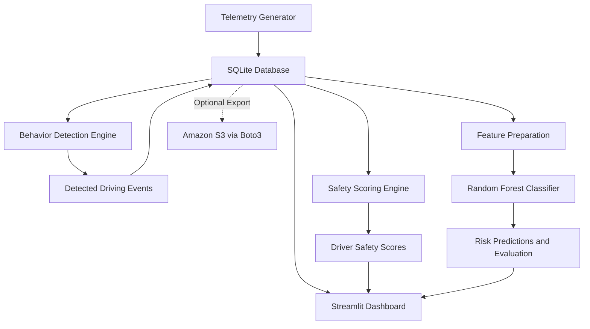

# Cloud-Based Driver Behavior Analytics Platform

A Python-based telematics analytics platform that simulates vehicle sensor data, detects unsafe driving behavior, calculates explainable driver safety scores, and uses machine learning to classify driving risks. The application provides an interactive Streamlit dashboard, local SQLite persistence, and optional Amazon S3 integration for cloud storage.

## Overview

Understanding driver behavior is important for improving road safety and managing vehicle fleets. This project demonstrates how simulated vehicle telemetry can be processed to identify risky driving patterns and present meaningful safety insights through an interactive dashboard.

The platform combines rule-based event detection, transparent scoring logic, and a Random Forest classifier to analyze driving behavior. It is designed with a local-first approach, so the core application can run without mandatory cloud infrastructure.

## Key Features

- **Vehicle Telemetry Simulation:** Generates simulated driving data for multiple drivers, including speed, acceleration, braking intensity, steering angle, and distance traveled.
- **Unsafe Driving Detection:** Identifies five types of risky behavior:
  - Overspeeding
  - Harsh braking
  - Rapid acceleration
  - Sharp turning
  - Excessive idling
- **Explainable Safety Scoring:** Calculates a driver safety score from 0 to 100 using configurable event penalties and severity multipliers.
- **Machine Learning Risk Classification:** Uses a Scikit-learn Random Forest classifier to predict driving risk categories from trip-level features.
- **Interactive Analytics Dashboard:** Displays fleet statistics, driver comparisons, driving trends, behavior distributions, and model evaluation results.
- **Local Data Persistence:** Uses SQLite to store and retrieve application data without requiring an external database server.
- **Optional Cloud Storage:** Integrates Amazon S3 through Boto3 to support telemetry archive uploads.
- **Automated Tests:** Includes a test suite for important platform components.

## Technology Stack

| Technology | Purpose |
|---|---|
| Python | Application logic and data processing |
| Pandas and NumPy | Telemetry processing and feature preparation |
| Scikit-learn | Random Forest training and risk classification |
| Streamlit | Interactive web application |
| Plotly | Interactive charts and visual analytics |
| SQLite | Local database and persistence |
| Joblib | Machine learning model serialization |
| Boto3 | Optional Amazon S3 integration |

## System Architecture

The application follows a modular pipeline in which simulated telemetry is stored, analyzed, scored, and presented through the dashboard.



## Project Structure

```text
Cloud-Based-Driver-Behavior-Analytics-Platform/
│
├── app.py                  # Streamlit dashboard
├── telemetry_generator.py  # Simulated vehicle telemetry
├── behavior_detector.py    # Unsafe driving event detection
├── safety_score.py         # Driver safety scoring and explanations
├── train_model.py          # Random Forest training and evaluation
├── database.py             # SQLite database operations
├── pipeline.py             # End-to-end processing pipeline
├── cloud_storage.py        # Optional Amazon S3 integration
├── test_platform.py        # Automated tests
│
├── requirements.txt        # Python dependencies
├── .env.example            # Example environment configuration
├── .gitignore              # Files excluded from version control
├── README.md               # Project documentation
│
├── data/
│   └── .gitkeep            # Preserves the data directory
│
└── models/
    └── .gitkeep            # Preserves the models directory
```

Generated databases, telemetry exports, and model artifacts may appear in the `data/` and `models/` directories when the application runs. Their availability depends on the execution workflow and Git ignore rules.

## Installation and Setup

### Prerequisites

- Python 3.10 or a compatible version supported by the project dependencies
- pip
- Git, if cloning the repository

### 1. Clone the Repository

```bash
git clone https://github.com/michelles1302/Cloud-Based-Driver-Behavior-Analytics-Platform.git
cd Cloud-Based-Driver-Behavior-Analytics-Platform
```

### 2. Create a Virtual Environment

On Windows PowerShell:

```powershell
python -m venv venv
.\venv\Scripts\Activate.ps1
```

On macOS or Linux:

```bash
python -m venv venv
source venv/bin/activate
```

### 3. Install Dependencies

```bash
python -m pip install -r requirements.txt
```

### 4. Initialize the Data Pipeline

Run the project's pipeline and model-training scripts:

```bash
python pipeline.py
python train_model.py
```

These commands follow the current project workflow. Check the console output for any dependency, data-generation, or model-training errors.

### 5. Launch the Dashboard

```bash
streamlit run app.py
```

Open the local URL printed in your terminal, usually:

`http://localhost:8501`

## How It Works

### 1. Telemetry Generation

The simulator creates vehicle telemetry for multiple drivers and trips. Its signals include:

- Vehicle speed in km/h
- Acceleration in m/s²
- Braking intensity
- Steering angle
- Distance traveled

The generated data provides the input for subsequent event detection and analytics.

### 2. Unsafe Driving Detection

The behavior detection module evaluates telemetry against configurable thresholds and identifies risky driving events.

| Event | Detection principle |
|---|---|
| Overspeeding | Speed exceeds the configured limit for a sustained period |
| Harsh braking | Strong negative acceleration |
| Rapid acceleration | Strong positive acceleration |
| Sharp turning | Large steering angle, subject to speed conditions |
| Excessive idling | Vehicle remains stationary for a configured duration |

Thresholds are project-defined settings intended for demonstration and can be adjusted according to the application requirements.

### 3. Driver Safety Scoring

The scoring engine starts with a base score of 100 and deducts points according to detected events and their severity.

The general calculation is:

**Total Penalty**

Sum of event base penalties multiplied by their severity multipliers.

**Normalized Penalty**

Total penalty divided by the applicable trip count, with a minimum divisor of one.

**Final Safety Score**

`max(0, min(100, 100 - Normalized Penalty))`

The dashboard presents the resulting score and its event-level breakdown, helping users understand which behaviors contributed to a driver's score.

The scoring formula is a project-defined heuristic, not an officially validated road-safety or insurance scoring standard.

### 4. Machine Learning Risk Classification

The project uses a Random Forest classifier to analyze trip-level features and classify driving risk.

Example input features include:

- Average and maximum speed
- Speed variability
- Minimum and maximum acceleration
- Harsh braking count
- Rapid acceleration count
- Sharp turning count
- Excessive idling duration
- Average absolute steering angle

The training module supports model evaluation using metrics such as accuracy, precision, recall, F1-score, and a confusion matrix.

Actual evaluation results depend on the generated or supplied training data and should be taken from the model's execution output rather than assumed in advance.

### 5. Interactive Dashboard

The Streamlit application organizes the analytics into sections for fleet-level and individual-driver analysis.

Depending on the available data and application configuration, the dashboard includes:

- **Fleet Overview:** Driver statistics, trip counts, safety-score summaries, and comparisons.
- **Driver Analysis:** Individual driver scores and event-level penalty explanations.
- **Trip Analytics:** Speed and acceleration time-series visualizations.
- **Behavior Analytics:** Distribution of detected unsafe driving events.
- **Machine Learning:** Model evaluation, feature importance, and interactive risk prediction.
- **Cloud Integration:** Amazon S3 configuration and backup functionality.

## Optional Cloud Integration: Amazon S3

The application is designed to run locally using SQLite. Amazon S3 integration is optional and is intended for cloud-based telemetry archiving.

To configure S3:

1. Copy `.env.example` to `.env`.
2. Enter your AWS configuration and bucket name using the variables documented in the example file.
3. Ensure the AWS identity has only the permissions needed for the intended S3 operations.
4. Follow the application's cloud integration instructions to configure and test uploads.

**Security considerations**

- Never commit real AWS credentials or secret keys.
- Keep `.env` out of version control.
- Use an appropriately configured IAM role or securely managed credentials.
- Review AWS pricing and storage policies before uploading data.

Without S3 configuration, the core application is intended to operate using local storage.

## Running Tests

The repository includes `test_platform.py` for testing key components.

Run:

```bash
python test_platform.py
```

The test suite is intended to cover areas such as:

- Telemetry generation and validation
- Unsafe behavior detection
- Safety-score calculations
- Database operations
- Machine learning inference
- Cloud-storage fallback behavior

Review the actual test output to determine whether all tests pass in your environment.

## Limitations

- **Simulated telemetry:** The project uses generated vehicle data rather than measurements collected from physical vehicles.
- **Heuristic thresholds:** Detection rules and scoring weights are configurable demonstration settings, not universally applicable safety standards.
- **Model generalization:** Predictions depend on the training data and feature quality. Results on simulated data do not establish real-world predictive performance.
- **Optional cloud services:** Amazon S3 requires separate AWS configuration and may incur charges.
- **Production readiness:** Real-world deployment would require further validation, security controls, operational monitoring, and testing with representative vehicle data.

## Future Enhancements

Potential extensions include:

- Integration with real vehicle telemetry or IoT devices
- More advanced driver-risk prediction models
- Historical trend analysis and driver-specific recommendations
- Scheduled cloud backups and retention policies
- Fleet alerts and configurable safety thresholds
- Validation using representative real-world driving datasets

## Project Purpose

This project demonstrates the integration of telemetry simulation, data processing, rule-based analytics, machine learning, visualization, database persistence, and optional cloud storage in one modular application.

It is intended for educational use, portfolio demonstration, and further experimentation with cloud-enabled analytics systems.

---

**Built with Python, Scikit-learn, Streamlit, Plotly, SQLite, and optional Amazon S3 integration.**
